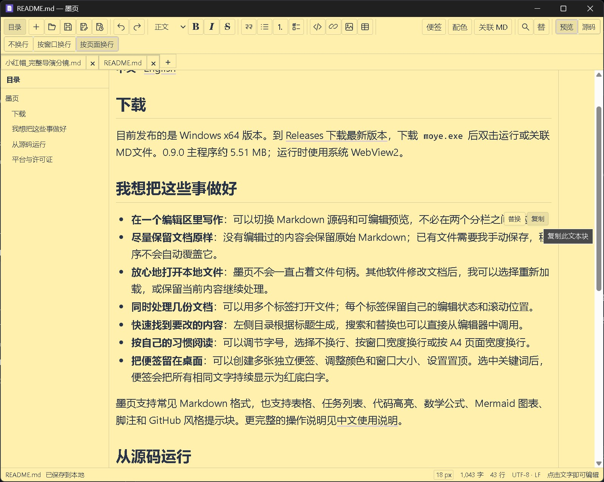

# 墨页

**中文** · [English](README_EN.md)

<p align="center">
  
</p>

## 下载

目前发布的是 Windows x64 版本。到 [Releases 下载最新版本](https://github.com/ahai1992/moye/releases/latest)，下载 `moye.exe` 后双击运行或关联MD文件。0.9.5 主程序约 5.74 MB；运行时使用系统 WebView2。

## 我想把这些事做好

- **在一个编辑区里写作**：可以切换 Markdown 源码和可编辑预览，不必在两个分栏之间找位置。
- **尽量保留文档原样**：没有编辑过的内容会保留原始 Markdown；已有文件需要我手动保存，程序不会自动覆盖它。
- **放心地打开本地文件**：墨页不会一直占着文件句柄。其他软件修改文档后，我可以选择重新加载，或保留当前内容继续处理。
- **同时处理几份文档**：可以用多个标签打开文件；每个标签保留自己的编辑状态和滚动位置。
- **快速找到要改的内容**：左侧目录根据标题生成，搜索和替换也可以直接从编辑器中调用。
- **按自己的习惯阅读**：可以调节字号，选择不换行、按窗口宽度换行或按 A4 页面宽度换行。
- **把便签留在桌面**：可以创建多张独立便签、调整颜色和窗口大小、设置置顶。选中关键词后，便签会把所有相同文字持续显示为红底白字。

墨页支持常见 Markdown 格式，也支持表格、任务列表、代码高亮、数学公式、Mermaid 图表、脚注和 GitHub 风格提示块。更完整的操作说明见[中文使用说明](release/使用说明.md)。

## 从源码运行

使用 Tauri 2、Rust 和 TypeScript 开发墨页。构建需要 Node.js 22.12 或更新版本、Rust stable / Cargo，以及目标平台的 Tauri 构建工具。Windows 还需要 MSVC C++ Build Tools 和 Windows SDK。

```powershell
npm install
npm run dev
```

编译 Windows EXE（不生成安装包）：

```powershell
npm run desktop:build -- --no-bundle
```

构建结果位于 `src-tauri/target/release/moye.exe`。我把发布程序放在 GitHub Releases，源码仓库不包含 EXE 和安装包。

## 平台与许可证

目前发布和验证的是 Windows 版本；macOS 与 Linux 尚未验证。

采用 [MIT License](LICENSE) 发布本项目。
