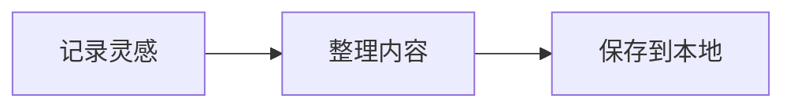

# 把想法，留在这一页

一份简单的本地笔记。点击文字就能修改，写作和阅读始终在同一个地方。

## 今天的计划

- [x] 整理本周的灵感
- [ ] 把一个想法写成完整的段落
- [ ] 留一点时间，读一读昨天的笔记

> 好的工具安静地待在一旁，让你专注于眼前的文字。

## Markdown，也可以很直观

你可以写下 **重要的事**，用 *斜体* 做一点强调，或者标记 ~~已经放下的念头~~。

| 内容 | 写法 | 适用场景 |
| :--- | :--- | :--- |
| 标题与段落 | 清晰分层 | 整理文章 |
| 清单与表格 | 一目了然 | 规划与记录 |
| 代码与公式 | 准确表达 | 技术笔记 |

### 留下一小段代码

```typescript
const note = {
  title: '今天的灵感',
  saved: true,
}

console.log(note.title)
```

### 也能写下公式

圆的面积是 $A = \pi r^2$，而一个值得记住的等式是：

$$
e^{i\pi} + 1 = 0
$$

### 用图表梳理过程



> [!TIP]
> 按 **Ctrl+S** 保存，按 **Ctrl+/** 切换源码与可编辑预览。

一页文字，可以是一切的开始。[^note]

[^note]: 文档保存在你选择的本地位置，公式和图表也可以离线显示。
